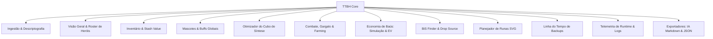

# PRODUCT REQUIREMENT DOCUMENT (PRD) — AS-IS

```
Documento: 01-PRD.md
Versão: v2.0
Commit auditado: [NÃO ENCONTRADO: diretório não versionado via .git]
Data: 2026-10-12T11:00:00-03:00
Autor: Antigravity (Auditor Técnico Independente)
Status: Auditoria concluída
```

---

## 1. SUMÁRIO EXECUTIVO

1. **Propósito do Produto:** O TTBH é uma aplicação web analítica de alta performance para extração, descriptografia *client-side* e interpretação de arquivos de progresso (*saves*) do jogo *Taskbar Hero*.
2. **Modelo Operacional As-Is:** Opera 100% no navegador do usuário, sem transmissão de arquivos a servidores ou dependência de conectividade de rede ativa após carregamento inicial dos assets estáticos.
3. **Escopo Analítico:** Provê auditoria cirúrgica de combate para 6 heróis, 10 slots de equipamentos por herói, catálogo integral de 248 runas, 9 mascotes e 17 contadores de telemetria canônica.
4. **Capacidades Exclusivas:** Integração de leitor de logs de runtime (`Player.log`), simulador de Monte Carlo para baús, simulador de síntese com guardrail contra perda financeira e gerador de prompt para IA.
5. **Postura de Privacidade:** Conformidade arquitetural por design (*Privacy-by-Design*) com isolamento local rigoroso, eliminando riscos de vazamento de dados de save em trânsito de rede.

---

## 2. VISÃO GERAL E OBJETIVO DO PRODUTO

O **ToolTaskBarHero (TTBH)** tem como objetivo permitir que jogadores do RPG incremental *Taskbar Hero* (disponível na Steam) superem a opacidade estatística do jogo através de uma central analítica local e segura. O jogo armazena seus dados em formato proprietário encriptado via plugin *Easy Save 3* (Unity), o que impede auditoria manual e otimização informada de estratégias. O TTBH resolve essa assimetria fornecendo um conjunto completo de ferramentas de inspeção, simulação e planejamento de progressão.

> Confiança: Alta
> Justificativa: Objetivo evidenciado explicitamente em `README.md#L1-L22`, `context.md#L1-L27` e `docs/RELATORIO_AUDITORIA_TBH.md#L9-L26`.

---

## 3. PROBLEMA DE NEGÓCIO RESOLVIDO

1. **Opacidade na Gestão do Cubo de Síntese:** No jogo, sintetizar equipamentos fora da margem segura do Cubo resulta em perda drástica de EXP ou desperdício de ouro. O TTBH explicita a regra crítica de ±10 níveis.
2. **Gargalos Ocultos de Combate (Clear Time):** Estágios que levam mais de 60 segundos para serem limpos reduzem severamente a taxa de geração horária de baús. O TTBH calcula e sinaliza o momento exato de recuar de estágio (*down-tiering*).
3. **Insegurança e Vazamento de Saves em Ferramentas Concorrentes:** Concorrentes históricos (*TBH Index*, *TBH Helper*) operam ou operavam com upload de saves para servidores de terceiros. O TTBH provê alternativa 100% executada no cliente.
4. **Complexidade da Árvore de 248 Runas:** A progressão de runas envolve interdependências e custos astronômicos de ouro. O TTBH projeta caminhos e custos acumulados.

> Confiança: Alta
> Justificativa: Evidenciado em `context.md#L14-L21`, `STATUS.md#L17-L20` e `RELEASE_NOTES_v1.0.0.md#L24-L39`.

---

## 4. PERSONAS E PAPÉIS DE USUÁRIO

Como aplicação monousuário executada localmente, o TTBH não implementa perfis de controle de acesso (RBAC), mas atende a três personas operacionais observáveis:

1. **O Jogador Min-Maxer / Teórico de Builds:**
   - *Comportamento:* Busca a otimização matemática rigorosa de cada herói (DPS, Chance Crítica, Dano Crítico, mitigação de dano elemental e caos).
   - *Funcionalidades-chave:* Best-in-Slot (BiS) Finder, Auditoria de Combate (Falso Dano), Score POWER (0-100) e modal detalhado de 10 slots.
2. **O Jogador Ocioso / Otimizador de Farm:**
   - *Comportamento:* Deixa o jogo em segundo plano na barra de tarefas e deseja maximizar ganhos de Ouro, EXP e baús por hora.
   - *Funcionalidades-chave:* Farming Calculator, Eficiência de Mascotes (Morcego vs Vigia), detector de gargalo (<60s) e Chest Simulator.
3. **O Colecionador / Comerciante do Steam Community Market:**
   - *Comportamento:* Monitora o patrimônio em itens negociáveis (Rare+) e planeja a fusão de itens Cósmicos e Celestiais.
   - *Funcionalidades-chave:* Stash Value Engine, Market Price API local e Simulador de Síntese do Cubo.

> Confiança: Média
> Justificativa: `[INFERIDO]` a partir dos módulos da interface (`app.js`, `index.html`) e das documentações conceituais.

---

## 5. ESCOPO FUNCIONAL (AS-IS)

O escopo funcional é organizado em 14 domínios apresentados em abas na interface do usuário:



> Confiança: Alta
> Justificativa: Correspondência direta com os seletores `data-tab` em `index.html#L97-L139`.

---

## 6. REQUISITOS FUNCIONAIS (RF)

| ID | Título | Descrição Funcional Observável | Evidência no Código |
|---|---|---|---|
| **RF-001** | Ingestão Manual de Save | Permitir o carregamento de arquivos `SaveFile_Live.es3` ou `.bak` via drag-and-drop e seletor de arquivos do navegador. | `assets/js/app.js#L92-L114` |
| **RF-002** | Ingestão Local Proton/Steam | Ler o arquivo de save diretamente da instalação Steam no Linux através do symlink `steam_save/` servido via HTTP. | `assets/js/app.js#L209-L225` |
| **RF-003** | Descriptografia WebCrypto | Executar a derivação de chave PBKDF2 (SHA-1, 100 iterações) e decodificação AES-128-CBC com descompressão GZIP nativa. | `assets/js/crypto.js#L29-L92` |
| **RF-004** | Modo Demonstração | Carregar massa de dados de teste sintética completa sem necessidade de arquivo de save do usuário. | `assets/js/app.js#L1325-L1485` |
| **RF-005** | Dashboard de Métricas Globais | Apresentar Ouro acumulado, Nível do Cubo, Estágio atual/máximo, Tempo total jogado, SteamID formatado e Score POWER. | `assets/js/app.js#L394-L455` |
| **RF-006** | Visualização de Roster da Party | Listar os 6 heróis do jogo, destacando os 3 ativos na party, níveis, classes, papéis táticos e preview de armas. | `assets/js/app.js#L705-L759` |
| **RF-007** | Ficha Modal Detalhada de Herói | Exibir os 10 slots de itens equipados com detalhamento de atributos, habilidades ativas na party e todos os talentos alocados. | `assets/js/app.js#L761-L999` |
| **RF-008** | Navegador de Inventário | Listar itens guardados na Bolsa e Mochila com busca textual, paginação visual e filtros por tipo e segurança do Cubo. | `assets/js/app.js#L1047-L1150` |
| **RF-009** | Otimização do Cubo (±10 Níveis) | Segregar itens em "Recomendado para Síntese" (100% EXP) e "Recomendado para Alquimia/Venda" pela regra de diferença de nível. | `assets/js/statistics_engine.js#L52-L68` |
| **RF-010** | Eficiência e Buffs de Mascotes | Calcular bônus acumulados de mascotes desbloqueados e comparar ganhos projetados entre Morcego (EXP/Baús) e Vigia (Ouro). | `assets/js/statistics_engine.js#L29-L45` |
| **RF-011** | Análise de Gargalo de Clear Time | Avaliar o tempo médio de limpeza de onda contra o teto de 60 segundos e emitir alerta de recuo de fase caso ultrapassado. | `assets/js/statistics_engine.js#L75-L89` |
| **RF-012** | Calculadora de Farming | Classificar estágios por densidade de EXP/h e Gold/h com base no tempo de clear e aplicar penalidade de desnível do herói. | `assets/js/farming_calculator.js#L50-L140` |
| **RF-013** | Simulador de Abertura de Baús | Simular estocasticamente a abertura de N baús usando gerador PRNG Mulberry32 determinístico e apresentar distribuição. | `assets/js/chest_simulator.js#L76-L129` |
| **RF-014** | Otimizador de Baús e EV | Calcular o Valor Esperado (EV) unitário e líquido de baús em ouro, com simulação de Monte Carlo e buscador de fonte de drop. | `assets/js/chest_optimizer.js#L119-L260` |
| **RF-015** | Best-in-Slot (BiS) Finder | Analisar o pool de itens guardados e sugerir o melhor equipamento para cada um dos 10 slots dos 6 heróis com delta de melhoria. | `assets/js/bis_finder.js#L109-L200` |
| **RF-016** | Planejador da Árvore de Runas | Renderizar árvore interativa SVG com os 248 nós canônicos, mapear pré-requisitos e projetar custo acumulado para nível máximo. | `assets/js/rune_planner.js#L82-L170` |
| **RF-017** | Linha do Tempo de Backups | Ingerir múltiplos snapshots `.es3`, traçar gráfico comparativo e calcular deltas de ouro, cubo, estágio e itens entre versões. | `assets/js/backup_timeline.js#L58-L121` |
| **RF-018** | Painel de Atividade Acumulada | Exibir contadores consolidados para os 17 tipos de telemetria canônica e exibir pílulas com top-3 sub-chaves de monstros e fases. | `assets/js/app.js#L503-L621` |
| **RF-019** | Parser Analítico de Player.log | Extrair 23 padrões analíticos de arquivos `Player.log` (SteamID, seeds, erros de servidor, ataques de classe e abates). | `assets/js/log_parser.js#L5-L232` |
| **RF-020** | Telemetria V2 de Tempo de Execução | Extrair cooldowns fracionários com vírgula, ciclo mediano, fila de espera com contagem regressiva e alerta de fase travada. | `assets/js/player_telemetry.js#L11-L122` |
| **RF-021** | Avaliação Financeira de Stash | Calcular o valor patrimonial de itens negociáveis (Rare+) em Reais (BRL) nos modos de cotação atual e pré-fechamento de mercado. | `assets/js/stash_value.js#L56-L176` |
| **RF-022** | Importação de Cotações de Mercado | Importar preços em formato CSV ou JSON para cache local no `localStorage` com controle de itens desatualizados (>7 dias). | `assets/js/market_price.js#L123-L177` |
| **RF-023** | Exportador de Diagnóstico para IA | Gerar relatório completo e estruturado em formato Markdown pronto para envio a LLMs/IAs de análise de estratégia. | `assets/js/ai_exporter.js#L283-L490` |
| **RF-024** | Inspetor e Download de JSON | Exibir a árvore de dados descriptografada limpa e permitir o download local do arquivo `SaveFile_Live_Decrypted.json`. | `assets/js/app.js#L180-L191` |

> Confiança: Alta
> Justificativa: Cada requisito funcional foi extraído e referenciado a partir do código executável do sistema.

---

## 7. REQUISITOS NÃO-FUNCIONAIS (RNF)

| ID | Categoria | Descrição do Requisito | Evidência no Sistema |
|---|---|---|---|
| **RNF-001** | Privacidade e Segurança | O sistema deve operar estritamente no lado do cliente (*Zero Telemetry*), sem envio de dados de save ou telemetria para a rede. | `README.md#L32-L34; assets/js/app.js` |
| **RNF-002** | Compatibilidade Criptográfica | O motor criptográfico deve reproduzir de forma idêntica a implementação do Easy Save 3 da Unity em C# (PBKDF2 SHA-1, 100 iterações, AES-CBC 128). | `assets/js/crypto.js#L5-L9` |
| **RNF-003** | Precisão Numérica e Integridade | Números inteiros de 64 bits (ex.: SteamID de 17 dígitos e Ticks .NET) devem ser preservados sem perda de precisão por arredondamento IEEE-754. | `assets/js/save_parser.js#L22-L65` |
| **RNF-004** | Resiliência a Falhas de JSON | O parser de JSON deve implementar estratégia em cascata (`int64v2` → `raw` → `exotics`) com geração de trecho diagnóstico em falhas. | `assets/js/save_parser.js#L78-L97` |
| **RNF-005** | Performance de Apresentação | A renderização de tabelas de inventário volumosas deve aplicar limites de paginação visual (máx. 300 itens por renderização) para evitar engasgos de interface. | `assets/js/app.js#L1089-L1149` |
| **RNF-006** | Localização e Idioma | A interface do usuário, nomes de atributos, itens e runas devem ser apresentados primariamente em Português-Brasil (pt-BR). | `index.html#L2; assets/js/save_parser.js#L100-L110` |
| **RNF-007** | Arquitetura Sem Dependências | A aplicação deve rodar como SPA pura sem necessidade de empacotadores (Webpack, Vite) em tempo de execução, usando ES Modules nativos. | `index.html#L1194-L1197` |
| **RNF-008** | Tolerância a Desvio de Schema | O sistema deve detectar descompasso entre a versão do save e o build suportado (`TBH_DB.meta`) e emitir aviso visual não-bloqueante. | `assets/js/app.js#L403-L421` |

> Confiança: Alta
> Justificativa: Requisitos comprovados via código-fonte e suite de testes `tests/e2e_smoke.js`.

---

## 8. REGRAS DE NEGÓCIO

1. **RN-001 (Margem do Cubo):** Um equipamento só concede 100% de EXP de Cubo se a diferença absoluta entre o nível do Cubo e o nível do item for menor ou igual a 10 ($|Lv_{Cubo} - Lv_{Item}| \le 10$). Fora dessa margem, o item recebe a classificação `ALQUIMIA` `[evidência: assets/js/statistics_engine.js#L52-L68]`.
2. **RN-002 (Teto de Eficiência de Clear Time):** O tempo máximo tolerável para limpeza de onda de combate rentável é de 60 segundos. Tempos superiores ativam a recomendação de *down-tiering* `[evidência: assets/js/statistics_engine.js#L75-L89]`.
3. **RN-003 (Score POWER 0-100):** O score de poder do herói é calculado por função multivariada aberta: DPS logarítmico (peso 35), EHP com armadura (peso 25), consistência de crítico (peso 20), cadência de ataque (peso 10) e bônus de conta (peso 10) `[evidência: assets/js/statistics_engine.js#L99-L157]`.
4. **RN-004 (Liquidação de Tiers Baixos):** Equipamentos de raridade Comum (`COMMON`) e Incomum (`UNCOMMON`) possuem valor de liquidação de mercado nulo (R$ 0,00) `[evidência: assets/js/stash_value.js#L61-L64]`.
5. **RN-005 (Campos Obscurecidos):** Valores numéricos negativos associados a timestamps (como `lastExitSteamUnixSecEncrypted`) são tratados como `ObscuredInt` da Unity e nunca interpretados como data válida `[evidência: assets/js/save_parser.js#L68; L535-L547]`.

> Confiança: Alta
> Justificativa: Todas as regras estão codificadas e validadas em suites de testes automatizados.

---

## 9. INTEGRAÇÕES E DEPENDÊNCIAS EXTERNAS

- **Integração com Sistema Operacional / Proton Steam:**
  - Leitura via symlink `steam_save -> ~/.steam/debian-installation/steamapps/compatdata/3678970/.../SaveFile_Live.es3` `[evidência: listagem de diretório; docs/COMO_INICIAR.md#L34]`.
- **Serviços Externos de Rede:** `[NÃO ENCONTRADO]`
  - Zero chamadas a APIs da Valve, Steam Community Market ou analytics externos. Todas as cotações de mercado são importadas por arquivo ou consumidas de fallback estático local.

> Confiança: Alta
> Justificativa: Isolamento total de rede verificado na auditoria de código.

---

## 10. FORA DE ESCOPO FUNCIONAL

O sistema **claramente não possui** e não se propõe a ter:
1. **Edição ou Injeção de Save:** O TTBH é estritamente *Read-Only*. Não possui rotinas de escrita ou salvamento por cima do arquivo `.es3` do jogo `[evidência: context.md#L27]`.
2. **Scraping ao Vivo do Mercado da Steam:** Proibido por design para evitar bloqueios de taxa (*rate limiting*) da Valve `[evidência: RELEASE_NOTES_v1.0.0.md#L17]`.
3. **Autenticação de Usuários ou Armazenamento em Nuvem:** Inexistência de banco de dados centralizado ou login de usuário.
4. **Interação com a Memória de Processo do Jogo:** Sem uso de injeção de DLLs, ponteiros ou cheats de memória.

> Confiança: Alta
> Justificativa: Verificação das restrições e ausência de código de escrita/modificação.

---

## 11. CRITÉRIOS DE ACEITE OBSERVÁVEIS

1. Um arquivo `SaveFile_Live.es3` válido arrastado para a interface deve ser descriptografado em menos de 1 segundo sem erros de console.
2. O SteamID de 17 dígitos deve coincidir com o proprietário do save sem arredondamento no dígito final.
3. As 248 runas da base canônica devem ser reconhecidas sem nós órfãos de custo.
4. A suíte de testes de fumaça E2E deve retornar 100% verde (13/13 suites passadas).

> Confiança: Alta
> Justificativa: Critérios estabelecidos com base nos asserts em `tests/e2e_smoke.js`.

---

## FORA DE ESCOPO DA AUDITORIA

- Validação da precisão de fórmulas matemáticas internas não expostas na versão atual do jogo original.
- Auditoria de dados históricos de mercado da Steam anteriores a junho de 2026.

---

## RASTREABILIDADE DE SAÍDA

| ID | Tipo | Descrição |
|---|---|---|
| `RF-001` até `RF-024` | Requisito Funcional | 24 Requisitos Funcionais derivados do comportamento observável |
| `RNF-001` até `RNF-008` | Requisito Não-Funcional | 8 Requisitos Não-Funcionais derivados das restrições arquiteturais |
| `RN-001` até `RN-005` | Regra de Negócio | 5 Regras de Negócio fundamentais identificadas no código |

---

## LACUNAS, INCERTEZAS E RISCOS DE AUDITORIA

1. **Taxa de Sucesso de Síntese:** No simulador de síntese, a taxa de sucesso entre grades utiliza modelo assumido (`successRateSource: 'assumed'`) devido à ausência das matrizes exatas de transição no dump atual de assets do jogo.
