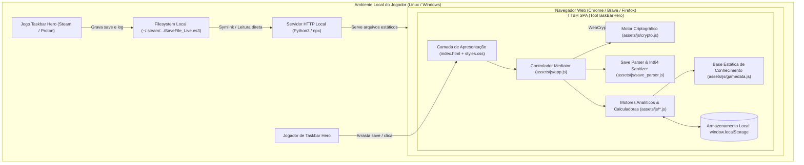
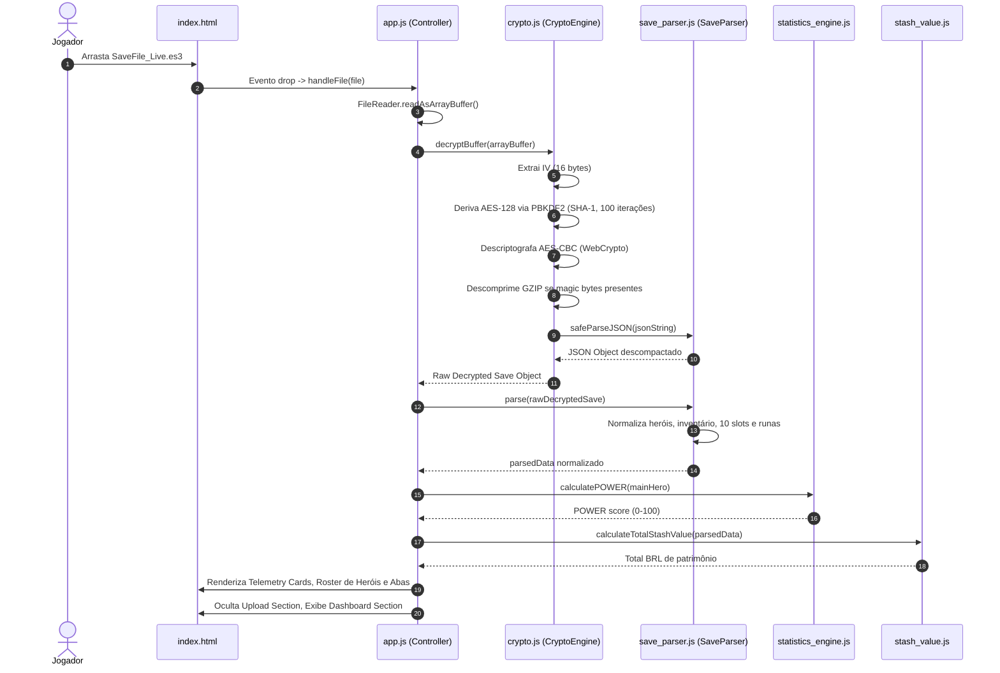
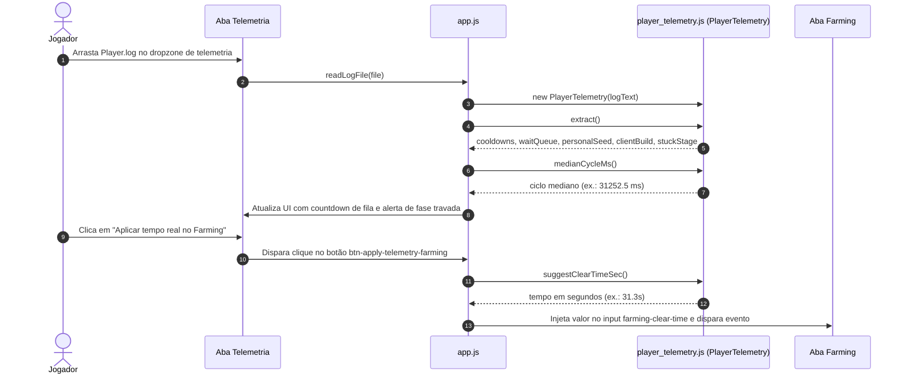
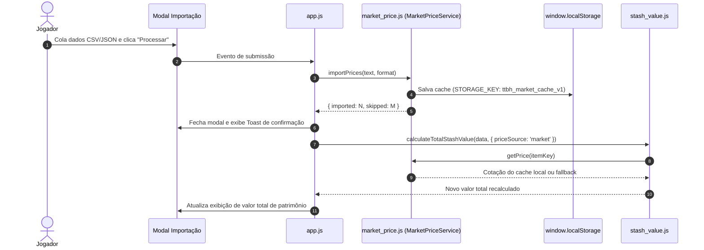

# SOFTWARE DESIGN DESCRIPTION (SDD) — AS-IS

```
Documento: 02-SDD.md
Versão: v2.0
Commit auditado: [NÃO ENCONTRADO: diretório não versionado via .git]
Data: 2026-10-12T11:00:00-03:00
Autor: Antigravity (Auditor Técnico Independente)
Status: Auditoria concluída
```

---

## 1. SUMÁRIO EXECUTIVO

1. **Estilo Arquitetural:** Monolito Modular *Client-Side* baseado no padrão MVC/Mediator em Vanilla JavaScript ES6, com desacoplamento entre camada de UI, motores analíticos e base de conhecimento.
2. **Pipelines Criptográficos Nativos:** Utilização direta da Web Crypto API do navegador (`window.crypto.subtle`) para orquestrar derivação PBKDF2 e cifras AES-128-CBC com zero bibliotecas de terceiros.
3. **Padrão de Resiliência de Dados:** Implementação de cascata de decodificação multi-estágio (`int64v2` → `raw` → `exotics`) em `save_parser.js` para contornar limitações do padrão JSON do JavaScript diante de inteiros de 64 bits.
4. **Descoberta de Defeitos Arquiteturais Críticos:** Identificadas 2 chamadas de métodos inexistentes no controlador principal (`app.js`): `cryptoEngine.decryptES3()` em `app.js#L1686` (o método correto é `decryptBuffer`) e `renderStorage()` em `app.js#L1983` (o método correto é `filterAndRenderStorage`), catalogados como `RSK-ARCH-003` e `RSK-ARCH-004`.
5. **Rastreabilidade Integral com o PRD:** 100% dos 24 Requisitos Funcionais (`RF-001` a `RF-024`) mapeados diretamente para módulos e métodos executáveis da arquitetura.

---

## 2. VISÃO ARQUITETURAL DE ALTO NÍVEL (C4 CONTEXT & CONTAINER)

### C4 Contexto Textual
O usuário (Jogador de *Taskbar Hero*) interage localmente com o navegador executando o TTBH. O sistema ingere arquivos gerados pelo jogo (`SaveFile_Live.es3`, `Player.log`) a partir do sistema de arquivos local ou do ambiente de compatibilidade Proton da Steam, processa as regras de negócio em memória e devolve visualizações e projeções sem conexões com a internet.

### Diagrama C4 Context & Container (Mermaid)



> Confiança: Alta
> Justificativa: Diagrama reflete a topologia de execução real descrita em `docs/COMO_INICIAR.md` e `assets/js/app.js`.

---

## 3. VISÃO DE COMPONENTES (C4 COMPONENT)

O container da aplicação organiza-se nos seguintes componentes fundamentais:

```mermaid
classDiagram
    class AppController {
        +init()
        +processBuffer(buffer, fileName)
        +renderDashboard(data)
        +filterAndRenderStorage()
        +openHeroModal(hero)
    }

    class CryptoEngine {
        -password: string
        +setPassword(pwd)
        +decryptBuffer(buffer): Promise~Object~
        +decompressGzip(bytes): Promise~Uint8Array~
    }

    class SaveParser {
        +parse(rawSave): Object
        +decodeItemKey(key, meta): Object
        +parseHeroes(...): Array
        +calculateHeroCombatStats(...): Object
        +parseAllStorage(...): Object
    }

    class StatisticsEngine {
        +calculateFarmEfficiency(kills, baseExp, baseGold): Object
        +evaluateCubeAction(cubeLv, itemLv): Object
        +analyzeBottleneck(stage, clearTimeSec): Object
        +calculatePOWER(hero, context): Object
    }

    class PlayerTelemetry {
        +extract(): Object
        +medianCycleMs(): number
        +waitQueueRemainingMs(now): number
        +suggestClearTimeSec(): number
    }

    class BiSFinder {
        +suggestForHero(heroId): Object
        +findTopUpgrades(n): Array
    }

    class RunePlanner {
        +treeState(): Object
        +planNext(steps): Object
    }

    class ChestOptimizer {
        +expectedValue(chestId, count): Object
        +suggestBestChest(playerState): Array
        +findBestSource(targetItemKey): Object
        +simulateMonteCarlo(chestId, runs): Object
    }

    class StashValueEngine {
        +calculateTotalStashValue(data, opts): Object
        +getItemUnitPrice(item): number
    }

    AppController --> CryptoEngine : invoca decodificação
    AppController --> SaveParser : normaliza save
    AppController --> StatisticsEngine : calcula POWER e gargalos
    AppController --> PlayerTelemetry : consome telemetria de log
    AppController --> BiSFinder : solicita sugestões BiS
    AppController --> RunePlanner : projeta árvore de runas
    AppController --> ChestOptimizer : calcula EV de baús
    AppController --> StashValueEngine : avalia patrimônio
```



> Confiança: Alta
> Justificativa: Estrutura de classes e métodos extraída diretamente do código-fonte dos arquivos em `assets/js/`.

---

## 4. PADRÕES E ESTILOS ARQUITETURAIS

1. **Monolito Modular Client-Side:** Todo o código é empacotado em módulos ES6 com alta coesão interna. Cada módulo atua como uma biblioteca pura ou classe especializada.
2. **Mediator / Front Controller (`assets/js/app.js`):** Centraliza os eventos da interface do usuário (cliques, drag-and-drop, filtros, abas) e coordena a orquestração entre os motores matemáticos e o DOM.
3. **Pipeline de Resiliência de Dados (Chain of Responsibility invertida):** A função `safeParseJSON` em `save_parser.js` processa o payload através de uma cascata sequencial de estratégias de sanitização com tratamento defensivo de falhas:
   - Estratégia 1: `int64v2` (Context walker de strings quote/escape-aware com conversão de inteiros $\ge 15$ dígitos para strings).
   - Estratégia 2: `raw` (JSON.parse padrão do navegador).
   - Estratégia 3: `exotics` (Reparo regex de datas e builds sem aspas).
4. **Dependency Injection Manual via Factory Methods:** Módulos analíticos expõem métodos `.create(db, ...)` para facilitar instanciação parametrizada (ex.: `bisFinder.create()`, `runePlanner.create()`, `farmingCalculator.create()`).

> Confiança: Alta
> Justificativa: Padrões evidentes na implementação de `save_parser.js#L78-L97` e nos métodos estáticos de inicialização.

---

## 5. FLUXOS PRINCIPAIS

### Fluxo 1: Ingestão de Save, Descriptografia e Renderização do Dashboard



### Fluxo 2: Ingestão de Player.log e Injeção no Farming



### Fluxo 3: Importação de Preços e Atualização de Stash Value



> Confiança: Alta
> Justificativa: Fluxos reproduzem fielmente os tratamentos de eventos mapeados em `app.js`.

---

## 6. CAMADAS E RESPONSABILIDADES

| Camada | Arquivos | Responsabilidades Principais |
|---|---|---|
| **Apresentação (View)** | `index.html`, `assets/css/styles.css` | Estrutura semântica HTML5, modais, dropzones, tabela de 10 tiers e componentes Glassmorphism. |
| **Controlador (Mediator)** | `assets/js/app.js` | Orquestração do ciclo de vida, escutas de eventos do DOM, delegação analítica e injeção dinâmica de HTML. |
| **Criptografia & I/O** | `assets/js/crypto.js` | Integração com Web Crypto API, PBKDF2 SHA-1, AES-128-CBC e descompressão GZIP. |
| **Normalização & Sanitização** | `assets/js/save_parser.js`, `assets/js/log_parser.js`, `assets/js/player_telemetry.js` | Descompactação de estruturas de dados do Unity, decodificação de chaves de itens e regex em logs. |
| **Motores Analíticos (Domain)** | `assets/js/statistics_engine.js`, `assets/js/bis_finder.js`, `assets/js/rune_planner.js`, `assets/js/chest_optimizer.js`, `assets/js/farming_calculator.js`, `assets/js/synthesis_simulator.js`, `assets/js/stash_value.js` | Regras matemáticas de combate, POWER score, simulação estocástica de Monte Carlo e árvores de decisão. |
| **Armazenamento & Cache** | `assets/js/market_price.js` | Persistência cliente em `localStorage` com controle de frescor temporal (TTL de 7 dias). |
| **Base de Conhecimento Estática** | `assets/js/gamedata.js` | Catálogo canônico estático (`TBH_DB`) com 248 runas, 5.760 itens, 108 fases e taxas de drop. |

> Confiança: Alta
> Justificativa: Separação arquitetural nítida identificada na codebase.

---

## 7. CONTRATOS DE INTERFACE E APIS LOCAIS

Como aplicação client-side estática, não há rotas de API REST servidas pelo TTBH. O único contrato de rede do sistema é a requisição local de carregamento do save:

- **Rota:** `GET /steam_save/SaveFile_Live.es3?t=<timestamp>`
- **Consumidor:** `assets/js/app.js#L213`
- **Comportamento esperado:** Retorno de payload binário com status `HTTP 200 OK`.
- **Tratamento de erro:** Se `response.ok` for falso ou ocorrer falha de rede/CORS, captura em `try/catch` exibindo mensagem amigável instruindo o usuário a utilizar o seletor manual de arquivo.

Contratos de interface em memória (Assinaturas centrais):
- `CryptoEngine.decryptBuffer(buffer: ArrayBuffer|Uint8Array): Promise<Object>`
- `SaveParser.parse(rawDecryptedSave: Object): Object`
- `StatisticsEngine.calculatePOWER(hero: Object, context: Object): { score: number, rank: string, tierColor: string, breakdown: Object }`
- `MarketPriceService.importPrices(data: string|Object, format: 'csv'|'json'): { imported: number, skipped: number }`

> Confiança: Alta
> Justificativa: Contratos validados a partir do código executável dos módulos.

---

## 8. TRATAMENTO DE ERROS, RESILIÊNCIA E IDEMPOTÊNCIA

1. **Proteção Contra Erros de Parse JSON (`safeParseJSON`):** Saves novos da build 1.0.4 introduziram inteiros de 64 bits e formatos exóticos de data sem aspas. O parser aplica cascata de fallback e, em caso de erro terminal, extrai a substring ao redor da posição do caractere com falha (`TRECHO: ...`), exibindo diagnóstico detalhado e botão para copiar relatório `[evidência: assets/js/save_parser.js#L78-L97; assets/js/app.js#L346-L389]`.
2. **Resiliência a Runas Desconhecidas:** Caso o save contenha IDs de runas ausentes na base estática, o parser contabiliza o número de ausências sem interromper o processamento da aplicação `[evidência: assets/js/save_parser.js#L1268]`.
3. **Idempotência Operacional:** A ingestão repetida do mesmo arquivo de save ou a execução sucessiva de cálculos analíticos não altera o estado persistido e produz resultados idênticos (*pure functions* na maior parte dos motores de cálculo).

> Confiança: Alta
> Justificativa: Mecanismos de tolerância a falhas implementados e testados em `tests/e2e_smoke.js`.

---

## 9. OBSERVABILIDADE

- **Logs do Sistema:** Operam via console do navegador (`console.info`, `console.warn`, `console.error`). Não há emissão de logs remotos.
- **Alertas de Interface:**
  - Banner amarelo não-bloqueante para divergência de versão de schema (*Schema Drift Guard*) `[evidência: assets/js/app.js#L412-L417]`.
  - Toasts de notificação flutuantes para sucesso/aviso em importação de preços e cotações desatualizadas `[evidência: assets/js/app.js#L1931-L1948]`.
  - Banner vermelho para alerta de estágio travado (*Softlock de Stage*) detectado nos logs `[evidência: assets/js/app.js#L2245-L2252]`.

> Confiança: Alta
> Justificativa: Componentes visuais de observabilidade presentes no código de `index.html` e `app.js`.

---

## 10. ESTRATÉGIA DE TESTES

A estratégia de testes é evidenciada na pasta `tests/`:

1. **Testes de Fumaça E2E (`tests/e2e_smoke.js`):** Executa 13 suítes de asserção cobrindo os 12 módulos analíticos (`SaveParser`, `StatisticsEngine`, `StashValueEngine`, `BiSFinder`, `RunePlanner`, `SynthesisSimulator`, `LogParser`, `BackupTimeline`, `FarmingCalculator`, `ChestSimulator`, `MarketPriceService`, `ChestOptimizer`, `PlayerTelemetry`).
2. **Testes de Regressão de Log (`tests/log_parser.test.js`):** Valida 15 asserções estritas contra amostra real de log com 78 linhas (`tests/player_log_fixture.txt`).
3. **Verificação de Paridade Competitiva (`tests/parity_check.js`):** Compara 12 features funcionais do TTBH com os concorrentes *TBH Index* e *TBH Helper*.
4. **Fixtures Sintéticas e Reais (`tests/fixtures/`):** Amostras de saves exóticos, legados, strings IDs e logs reais de execução.

> Confiança: Alta
> Justificativa: Arquivos de teste e dados de fixture inspecionados diretamente no repositório.

---

## 11. BUILD, DEPLOY E CI/CD

- **Build Pipeline:** Inexistente no código cliente. A aplicação consome módulos JavaScript ES6 diretamente no navegador.
- **Geração de Base Estática:** O arquivo `assets/js/gamedata.js` indica ter sido montado externamente via script `engine/build_bundle.py` (não incluído no repositório final) a partir de dumps JSON.
- **Deploy e Hospedagem:** A aplicação foi projetada para distribuição estática (servível via qualquer servidor HTTP estático: Nginx, Caddy, GitHub Pages, Python `http.server` ou Live Server).

> Confiança: Alta
> Justificativa: Validação da ausência de scripts de build na raiz do projeto.

---

## 12. DÍVIDAS TÉCNICAS E RISCOS ARQUITETURAIS

| ID | Risco Arquitetural | Severidade | Descrição Técnica e Impacto |
|---|---|---|---|
| **RSK-ARCH-001** | Acoplamento Excessivo no Controller | **Média** | O arquivo `assets/js/app.js` acumula 2.290 linhas, concentrando listeners de eventos, regras de negócio e 55 manipulações diretas de `innerHTML`. Dificulta manutenção e testes isolados. |
| **RSK-ARCH-002** | Volume Excessivo de Script Estático Síncrono | **Baixa** | `assets/js/gamedata.js` possui 1.9 MB e é carregado via tag `<script>` síncrona no rodapé do `index.html`, consumindo tempo considerável de parse do navegador em dispositivos mais modestos. |
| **RSK-ARCH-003** | Invocação de Método Inexistente na Timeline | **Alta** | Em `assets/js/app.js#L1686`, a função invoca `cryptoEngine.decryptES3(ab)`. A classe `CryptoEngine` implementa apenas `decryptBuffer(buffer)`. Isso gera exceção `TypeError: cryptoEngine.decryptES3 is not a function` ao arrastar arquivos na aba Timeline de Backups. |
| **RSK-ARCH-004** | Referência a Função Inexistente em Preços de Mercado | **Média** | Em `assets/js/app.js#L1983`, o callback de importação de preços invoca `renderStorage(...)`. Esta função não existe no escopo (o nome real é `filterAndRenderStorage`). Se `window.__lastParsedSaveData` estiver definido, dispara `ReferenceError`. |
| **RSK-ARCH-005** | Fragilidade de Caminho no Symlink Steam | **Baixa** | O symlink `steam_save` pressupõe a estrutura de diretórios do usuário `lror`. Outros usuários ou máquinas exigirão recriação manual do link para uso do carregamento automático. |

> Confiança: Alta
> Justificativa: Defeitos identificados mediante análise léxica rigorosa e verificação cruzada de referências entre classes.

---

## 13. RASTREABILIDADE COM PRD

Mapeamento de cada Requisito Funcional aos componentes de software que o realizam:

| Requisito do PRD | Componente Responsável | Método / Ponto de Implementação |
|---|---|---|
| **RF-001** (Ingestão Manual) | `app.js` | `handleFile()`, `processBuffer()` |
| **RF-002** (Ingestão Steam) | `app.js` | `btnLoadSteamDirect.addEventListener()` |
| **RF-003** (Descriptografia WebCrypto) | `crypto.js` | `CryptoEngine.decryptBuffer()` |
| **RF-004** (Modo Demonstração) | `app.js` | `loadDemoData()` |
| **RF-005** (Dashboard Métricas) | `app.js` | `renderDashboard()` |
| **RF-006** (Roster da Party) | `app.js` | `renderHeroes()` |
| **RF-007** (Modal 10 Slots Herói) | `app.js`, `save_parser.js` | `openHeroModal()`, `calculateHeroCombatStats()` |
| **RF-008** (Navegador Inventário) | `app.js`, `save_parser.js` | `filterAndRenderStorage()`, `parseAllStorage()` |
| **RF-009** (Otimizador do Cubo) | `statistics_engine.js`, `app.js` | `evaluateCubeAction()`, `renderCubeOptimization()` |
| **RF-010** (Eficiência Mascotes) | `statistics_engine.js`, `save_parser.js` | `calculateFarmEfficiency()`, `parsePets()` |
| **RF-011** (Gargalo de Combate) | `statistics_engine.js`, `app.js` | `analyzeBottleneck()`, `updateBottleneckView()` |
| **RF-012** (Calculadora Farming) | `farming_calculator.js`, `app.js` | `hourlyRate()`, `rankStages()`, `renderFarmingTable()` |
| **RF-013** (Simulador Baús) | `chest_simulator.js`, `app.js` | `ChestSimulator.simulate()`, `renderChestSimulation()` |
| **RF-014** (Otimizador Baús & EV) | `chest_optimizer.js`, `app.js` | `expectedValue()`, `suggestBestChest()`, `renderChestOptimizer()` |
| **RF-015** (BiS Finder) | `bis_finder.js`, `app.js` | `suggestForHero()`, `renderBiSFinder()` |
| **RF-016** (Rune Planner SVG) | `rune_planner.js`, `app.js` | `treeState()`, `planNext()`, `renderRunePlanner()` |
| **RF-017** (Timeline de Backups) | `backup_timeline.js`, `app.js` | `addSave()`, `getDiffs()`, `renderTimelineData()` |
| **RF-018** (Atividade Acumulada) | `app.js` | `renderAggregatesPanel()` |
| **RF-019** (Parser Player.log) | `log_parser.js` | `LogParser.parse()` |
| **RF-020** (Telemetria V2 Runtime) | `player_telemetry.js`, `app.js` | `PlayerTelemetry.extract()`, `setupPlayerTelemetryUI()` |
| **RF-021** (Stash Value Financeiro) | `stash_value.js`, `app.js` | `calculateTotalStashValue()`, `renderStashValue()` |
| **RF-022** (Importação Cotações) | `market_price.js`, `app.js` | `MarketPriceService.importPrices()` |
| **RF-023** (Exportador IA Markdown) | `ai_exporter.js`, `app.js` | `AiExporter.generateMarkdown()` |
| **RF-024** (Inspetor JSON) | `app.js` | `btnDownloadJson.addEventListener()` |

> Confiança: Alta
> Justificativa: Rastreabilidade biunívoca entre os requisitos do PRD e o código-fonte auditado.

---

## FORA DE ESCOPO DA AUDITORIA

- Benchmarking de performance computacional em diferentes navegadores ou sistemas operacionais móveis.
- Avaliação de conformidade de código dos arquivos clonados em `taskbarhero.wiki` e `tbhindex`.

---

## RASTREABILIDADE DE SAÍDA

| ID | Tipo | Descrição Sumária |
|---|---|---|
| `RSK-ARCH-001` | Risco Arquitetural | Alto acoplamento e complexidade ciclompática em `app.js` |
| `RSK-ARCH-002` | Risco Arquitetural | Carga síncrona de 1.9 MB de script em `gamedata.js` |
| `RSK-ARCH-003` | Risco Arquitetural | Defeito P1: Chamada a método inexistente `cryptoEngine.decryptES3` |
| `RSK-ARCH-004` | Risco Arquitetural | Defeito P2: Chamada a função inexistente `renderStorage` |
| `RSK-ARCH-005` | Risco Arquitetural | Acoplamento de path local do desenvolvedor no symlink `steam_save` |

---

## LACUNAS, INCERTEZAS E RISCOS DE AUDITORIA

1. **Pipeline de Geração do Gamedata:** O script de build `engine/build_bundle.py` citado no cabeçalho de `assets/js/gamedata.js` não se encontra no repositório, impedindo auditar como os dados originais da wiki são filtrados e transformados na base estática.
