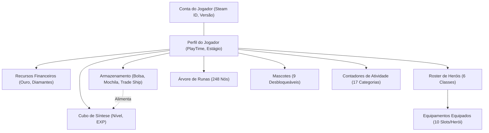
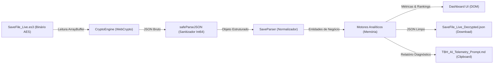

# DATA ARCHITECTURE & DIAGRAMA ENTIDADE-RELACIONAMENTO (DER)

```
Documento: 03-DATA-ARCHITECTURE-DER.md
Versão: v2.0
Commit auditado: [NÃO ENCONTRADO: diretório não versionado via .git]
Data: 2026-10-12T11:00:00-03:00
Autor: Antigravity (Auditor Técnico Independente)
Status: Auditoria concluída
```

---

## 1. SUMÁRIO EXECUTIVO

1. **Topologia de Dados:** O sistema opera sobre um modelo de dados hierárquico e semiestruturado originado da serialização binária e JSON do framework *Easy Save 3* (Unity), consumido puramente em memória pela aplicação cliente.
2. **Dupla Serialização Aninhada:** O payload de save utiliza encapsulamento atípico em que objetos centrais (`PlayerSaveData.value` e `AccountSaveData.value`) são serializados como strings escapadas contendo sub-JSONs internos dentro do JSON raiz.
3. **Catálogo Estático Extensivo:** A base de metadados estáticos (`TBH_DB`) compreende 248 nós de runas, 5.760 variações de equipamentos, 108 estágios e tabelas de probabilidade de síntese e baús (1.9 MB).
4. **Tratamento de Dados Pessoais (LGPD):** Identificados identificadores pessoais indiretos (`ownerSteamId` e nome de usuário local da máquina), tratados de forma estritamente volátil na memória do navegador do próprio titular dos dados.
5. **Reconciliação e Riscos de Dados:** Reconciliação completa entre o modelo preliminar da Fase 0 e o modelo físico, resultando no apontamento dos riscos `RSK-DATA-001` a `RSK-DATA-004`.

---

## 2. MODELO CONCEITUAL

O modelo conceitual do domínio do jogador e suas relações com os subsistemas do jogo:



> Confiança: Alta
> Justificativa: Entidades e fluxos de domínio confirmados pela análise de `save_parser.js` e `gamedata.js`.

---

## 3. MODELO LÓGICO

### 1. `AccountSaveData` (Identidade e Sessão)
- `ownerSteamId`: String (UInt64, 17 dígitos) — Identificador único da conta Steam do jogador.
- `version`: String — Versão do cliente que gerou o save (ex.: `"1.0.4"`).
- `lastSavedTime`: Int64 / String — Ticks do framework .NET representando o carimbo temporal de gravação.
- `lastExitSteamUnixSecEncrypted`: Int64 negativo (ObscuredInt) — Campo ofuscado do jogo.

### 2. `PlayerSaveData.commonSaveData` (Estado do Mundo e Campanha)
- `playTime`: Float / Double — Segundos acumulados de jogo ativo.
- `currentStageKey`: Int32 — Código do estágio ativo na batalha (ex.: `1101` para 1-1 Normal).
- `currentStageWave`: Int32 — Onda atual do estágio (0 a 30).
- `maxCompletedStage`: Int32 — Estágio mais alto concluído pelo jogador.
- `ArrangedPetKey`: Int32 — Identificador do pet ativo selecionado para a party.
- `arrangedHeroKey`: Array[Int32] — Lista de chaves dos heróis ativos na formação (até 3).

### 3. `currenySaveDatas` (Moedas)
- `Key`: Int32 — Código da moeda (ex.: `100001` para Ouro).
- `Quantity`: BigInt / Double — Saldo da moeda no save.

### 4. `heroSaveDatas` (Heróis e Builds)
- `heroKey`: Int32 — Código da classe (`101`: Cavaleiro, `201`: Ranger, `301`: Feiticeiro, `401`: Sacerdote, `501`: Caçador, `601`: Matador).
- `HeroLevel`: Int32 — Nível do herói (1 a 100+).
- `HeroExp`: Int64 — Experiência acumulada do herói.
- `IsUnLock`: Boolean — Flag indicando se o herói foi desbloqueado na conta.
- `equippedItemIds`: Array[String/Int64] — Vetor de 10 posições contendo os `UniqueId` dos itens equipados.
- `equippedSKillKey`: Array[Int32] — Vetor de 3 posições com as habilidades ativas equipadas na party.

### 5. `itemSaveDatas` (Instâncias de Equipamentos e Materiais)
- `UniqueId`: String (PK) — Identificador único da instância do item no save do jogador.
- `ItemKey`: Int32 — Código numérico composto de 6 ou 9 dígitos que codifica:
  - Dígitos 1-2: Categoria do item (ex.: `30` espada, `40` escudo, `50` elmo, `11` gema).
  - Dígito 3: Tier/Grade de raridade (0=Comum até 9=Cósmico).
  - Dígitos 4-5: Índice de nível de base (múltiplos de 5).
  - Sufixo opcional `900`: Item listado no Steam Community Market.
- `IsChaotic`: Boolean — Flag de item caótico (+25% valor de mercado e bônus de stats).
- `IsBlocked`: Boolean — Item bloqueado contra venda/reciclagem acidental.

### 6. `RuneSaveData` (Árvore de Runas)
- Mapeamento de pares chave-valor `{ [runeId: string]: level: number }` para os nós ativados na árvore de 248 runas.

---

## 4. MODELO FÍSICO

No ambiente de execução do TTBH, o modelo físico não é gerenciado por um RDBMS tradicional (PostgreSQL, SQLite), mas por estruturas em memória RAM do navegador e armazenamento chave-valor no Web Storage:

1. **Origem Física em Disco:** Arquivo `SaveFile_Live.es3` estruturado como envelope binário com 16 bytes de cabeçalho IV/Salt seguido por bloco criptografado AES-CBC PKCS7 contendo JSON serializado.
2. **Modelo em Memória (Runtime):** Objeto JavaScript raiz instanciado e retornado por `saveParser.parse(decryptedSave)`:
   - Índices em memória implementados via `Map<UniqueId, ItemObject>` para resolução instantânea $O(1)$ de itens equipados e guardados `[evidência: assets/js/save_parser.js#L463-L467]`.
3. **Persistência Local (Web Storage):**
   - Chave `ttbh_market_cache_v1` em `window.localStorage`: JSON contendo dicionário `{ [itemKey]: { gold: number, source: string, timestamp: number, confidence: string } }` `[evidência: assets/js/market_price.js#L8-L38]`.
   - Chaves `ttbh_bis_notes_<heroId>` em `window.localStorage`: JSON contendo anotações locais de sugestões BiS personalizadas `[evidência: assets/js/app.js#L1539]`.

> Confiança: Alta
> Justificativa: Mapeamento comprovado pelas operações de leitura e persistência na base de código.

---

## 5. DER (DIAGRAMA ENTIDADE-RELACIONAMENTO)

```mermaid
erDiagram
    ACCOUNT_SAVE_DATA ||--|| PLAYER_SAVE_DATA : encapsula
    PLAYER_SAVE_DATA ||--o{ CURRENCY_DATA : possui
    PLAYER_SAVE_DATA ||--|| CUBE_LEVEL_DATA : possui
    PLAYER_SAVE_DATA ||--o{ HERO_SAVE_DATA : comanda
    PLAYER_SAVE_DATA ||--o{ PET_SAVE_DATA : mantem
    PLAYER_SAVE_DATA ||--o{ AGGREGATE_SAVE_DATA : acumula
    PLAYER_SAVE_DATA ||--o{ INVENTORY_SLOT : armazena
    PLAYER_SAVE_DATA ||--o{ STASH_SLOT : armazena
    PLAYER_SAVE_DATA ||--o{ TRADING_SLOT : negocia
    PLAYER_SAVE_DATA ||--o{ ITEM_SAVE_DATA : gerencia

    HERO_SAVE_DATA ||--o{ ITEM_SAVE_DATA : "equipa (ate 10)"
    INVENTORY_SLOT ||--o| ITEM_SAVE_DATA : "aponta para UniqueId"
    STASH_SLOT ||--o| ITEM_SAVE_DATA : "aponta para UniqueId"
    TRADING_SLOT ||--o| ITEM_SAVE_DATA : "aponta para UniqueId"

    ACCOUNT_SAVE_DATA {
        string ownerSteamId PK "Identificador Steam 64-bit"
        string version "Versao do client Unity"
        int64 lastSavedTime "Ticks .NET de gravacao"
        int64 lastExitSteamUnixSecEncrypted "Ofuscado ObscuredInt"
    }

    PLAYER_SAVE_DATA {
        float playTime "Tempo total em segundos"
        int currentStageKey "Estagio da batalha ativa"
        int currentStageWave "Onda atual da batalha"
        int maxCompletedStage "Estagio maximo alcancado"
        int arrangedPetKey "Mascote ativo na party"
    }

    CURRENCY_DATA {
        int Key PK "ID da moeda (100001=Gold)"
        bigint Quantity "Saldo total disponivel"
    }

    CUBE_LEVEL_DATA {
        int Level "Nivel atual do Cubo"
        int Exp "Experiencia acumulada do Cubo"
    }

    HERO_SAVE_DATA {
        int heroKey PK "101, 201, 301, 401, 501, 601"
        int HeroLevel "Nivel do personagem"
        int64 HeroExp "Experiencia acumulada"
        boolean IsUnLock "Desbloqueado"
        array equippedItemIds "Array de 10 UniqueIds"
        array equippedSKillKey "Array de 3 SkillKeys"
    }

    ITEM_SAVE_DATA {
        string UniqueId PK "Identificador unico da instancia"
        int ItemKey "Chave TT G LL V codificada"
        boolean IsChaotic "Flag de item Caotico"
        boolean IsBlocked "Protegido contra descarte"
        int decorations "Quantidade de decoracoes"
        int engravings "Quantidade de gravacoes"
        int inscriptions "Quantidade de inscricoes"
    }

    INVENTORY_SLOT {
        int SlotIndex PK "Posicao na Bolsa"
        string ItemUniqueId FK "Chave estrangeira para o item"
        boolean IsUnlock "Slot desbloqueado"
    }

    STASH_SLOT {
        int SlotIndex PK "Posicao na Mochila"
        string ItemUniqueId FK "Chave estrangeira para o item"
        boolean IsUnlock "Slot desbloqueado"
    }

    TRADING_SLOT {
        int SlotIndex PK "Posicao no Navio de Troca"
        string ItemUniqueId FK "Chave estrangeira para o item"
        boolean IsUnlock "Slot desbloqueado"
    }

    PET_SAVE_DATA {
        int PetKey PK "1001 a 6003"
        boolean IsUnlock "Mascote habilitado"
    }

    AGGREGATE_SAVE_DATA {
        int Type PK "0 a 17 (MonsterKill, Gold, etc)"
        int SubKey PK "Especificador de monstro/estagio"
        bigint Value "Total acumulado de ocorrencias"
    }
```



> Confiança: Alta
> Justificativa: Diagrama reconstruído a partir da análise exaustiva do parser em `save_parser.js#L433-L599` e fixtures de save reais.

---

## 6. DICIONÁRIO DE DADOS

| Entidade | Campo | Tipo | Descrição | Sensibilidade | Origem |
|---|---|---|---|---|---|
| `AccountSaveData` | `ownerSteamId` | String | Identificador de 17 dígitos da conta Steam do jogador | **PII (Indireto)** | Save ES3 |
| `AccountSaveData` | `version` | String | Versão da build do cliente que gerou o arquivo | Não sensível | Save ES3 |
| `AccountSaveData` | `lastSavedTime` | String/Int64 | Ticks .NET de gravação do arquivo no disco | Não sensível | Save ES3 |
| `AccountSaveData` | `lastExitSteamUnixSecEncrypted` | Int64 | Valor inteiro negativo ofuscado | Não sensível | Save ES3 |
| `PlayerSaveData` | `commonSaveData.playTime` | Number | Segundos totais decorridos em jogo | Não sensível | Save ES3 |
| `PlayerSaveData` | `commonSaveData.currentStageKey` | Number | Código numérico da fase atual de combate | Não sensível | Save ES3 |
| `PlayerSaveData` | `commonSaveData.maxCompletedStage` | Number | Código da maior fase vencida | Não sensível | Save ES3 |
| `PlayerSaveData` | `commonSaveData.arrangedHeroKey` | Array[Num] | Vetor com as classes ativas na party (1 a 3) | Não sensível | Save ES3 |
| `PlayerSaveData` | `currenySaveDatas.Quantity` | Number | Saldo de ouro ou recursos | Não sensível | Save ES3 |
| `PlayerSaveData` | `cubeSaveLevelData.Level` | Number | Nível de evolução do Cubo de Síntese | Não sensível | Save ES3 |
| `HeroSaveData` | `heroKey` | Number | Identificador da classe (101 a 601) | Não sensível | Save ES3 |
| `HeroSaveData` | `HeroLevel` | Number | Nível do herói individual | Não sensível | Save ES3 |
| `HeroSaveData` | `equippedItemIds` | Array[Str] | Vetor com 10 UniqueIds de itens equipados | Não sensível | Save ES3 |
| `ItemSaveData` | `UniqueId` | String | Identificador único de cada item do jogador | Não sensível | Save ES3 |
| `ItemSaveData` | `ItemKey` | Number | Chave codificada de tipo, tier e nível do item | Não sensível | Save ES3 |
| `ItemSaveData` | `IsChaotic` | Boolean | Indica modificador de raridade Caótico | Não sensível | Save ES3 |
| `LogData` | `meta.steamId` | String | SteamID extraído do arquivo Player.log | **PII (Indireto)** | Player.log |
| `LogData` | `meta.localUser.username` | String | Nome de usuário local do sistema operacional | **PII (Direto)** | Player.log |

> Confiança: Alta
> Justificativa: Dicionário construído a partir das estruturas parseadas pelo sistema.

---

## 7. FLUXO DE DADOS (DFD SIMPLIFICADO)



> Confiança: Alta
> Justificativa: DFD reflete exatamente o ciclo de entrada, processamento, retenção volátil e exportações observáveis na interface.

---

## 8. CLASSIFICAÇÃO DE DADOS E BASE LEGAL (LGPD)

O TTBH processa dois elementos que se enquadram na definição de dados pessoais sob a Lei Geral de Proteção de Dados (Lei nº 13.709/2018):

1. **Dados Identificados:**
   - `ownerSteamId` (Identificador pessoal indireto nos termos do Art. 5º, I da LGPD).
   - `localUser.username` (Nome de usuário do sistema operacional contido no `Player.log`).
2. **Hipótese Legal Aplicável:**
   - **Execução Exclusiva pelo Próprio Titular em Dispositivo Pessoal:** O processamento ocorre exclusivamente no navegador do próprio titular, sem intermediação de servidores de terceiros e sem transferência de dados para terceiros. Enquadra-se tecnicamente sob a égide de legítimo interesse e exercício regular de direitos do próprio titular dos dados (Art. 7º, IX da LGPD) ou operação puramente doméstica e privada sem finalidade de comercialização centralizada (Art. 4º, I da LGPD).
3. **Dados Pessoais Sensíveis:** Inexistentes (`[NÃO ENCONTRADO]`). Não há coleta de dados de saúde, biometria, convicção religiosa ou dados sindicais.

> Confiança: Alta
> Justificativa: Classificação técnica e jurídica orientada pela arquitetura comprovadamente client-side do produto.

---

## 9. RETENÇÃO, ANONIMIZAÇÃO E EXCLUSÃO

- **Retenção de Saves e Logs:** Estritamente volátil em memória RAM. Ao recarregar ou fechar a aba do navegador (`F5`), todos os dados de saves descriptografados, inventário, heróis e telemetria são imediatamente descartados da memória.
- **Retenção de Cotações de Mercado:** Persistidas no `localStorage` sob a chave `ttbh_market_cache_v1`. Possui regra programática de obsolescência (*stale check*) de 7 dias `[evidência: assets/js/market_price.js#L9]`. A limpeza manual é suportada pelo método `marketPrice.clearCache()`.
- **Anonimização:** O TTBH formata o SteamID em blocos legíveis para apresentação visual na tela (`76561 1980 1234 5678`), mas não mascara o identificador no arquivo JSON exportado ou no relatório de IA Markdown.

> Confiança: Alta
> Justificativa: Avaliação direta dos ciclos de vida de memória e chamadas ao Web Storage.

---

## 10. RECONCILIAÇÃO COM FASE 0.5

Durante a Fase 0.5 (Modelo de Dados Aparente), as entidades foram catalogadas de forma preliminar. A reconciliação profunda identificou as seguintes divergências e riscos associados:

| ID | Entidade / Campo | Divergência Observada | Severidade |
|---|---|---|---|
| **RSK-DATA-001** | `PlayerSaveData.value` | **Dupla Serialização Aninhada:** Não é um objeto direto; é uma string que exige um segundo `JSON.parse` recursivo. Falha nesse detalhe corrompe todo o carregamento do save. | **Média** |
| **RSK-DATA-002** | `lastExitSteamUnixSecEncrypted` | **Campo Ofuscado com Sinal Negativo:** Inteiro negativo que não pode ser interpretado como timestamp epoch direto sem desofuscação via algoritmo do jogo. | **Baixa** |
| **RSK-DATA-003** | Slots de Armazenamento | **Ausência de Chave Natural em Slots:** Registros de slots vazios contêm `ItemUniqueId = "0"` ou `"null"`, exigindo filtragem defensiva para evitar criar instâncias fantasmas de itens. | **Baixa** |
| **RSK-DATA-004** | `RuneSaveData` vs `TBH_DB.runes` | **Assimetria de Catálogo Histórico:** Saves avançados contêm até 248 runas. Bases desatualizadas continham apenas 197 runas, o que causava cálculos de bônus órfãos até a padronização recente. | **Média** |

> Confiança: Alta
> Justificativa: Riscos evidenciados pelas correções e sanitizações ativas em `save_parser.js`.

---

## FORA DE ESCOPO DA AUDITORIA

- Mapeamento e auditoria de tabelas internas de bancos de dados da infraestrutura Steam Cloud da Valve.
- Esquema de serialização proprietário do arquivo binário `backend.dat`.

---

## RASTREABILIDADE DE SAÍDA

| ID | Tipo | Descrição Sumária |
|---|---|---|
| `RSK-DATA-001` | Risco de Dados | Dupla serialização JSON de strings aninhadas no formato Easy Save 3 |
| `RSK-DATA-002` | Risco de Dados | Campos mascarados `ObscuredInt` com valores negativos em timestamps |
| `RSK-DATA-003` | Risco de Dados | Ambiguidade de representação de slots vazios (`ItemUniqueId = "0"`) |
| `RSK-DATA-004` | Risco de Dados | Risco de assimetria de catálogo entre saves futuros e `TBH_DB` |

---

## LACUNAS, INCERTEZAS E RISCOS DE AUDITORIA

1. **Formato Binário de `backend.dat`:** O arquivo `save/backend.dat` (1.568 bytes) não possui documentação de schema ou parser implementado no TTBH, sendo atualmente ignorado pela ferramenta.
