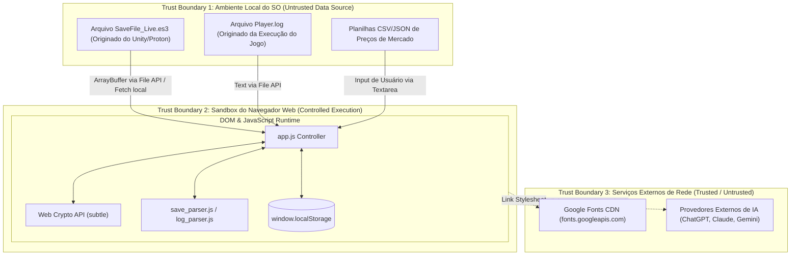
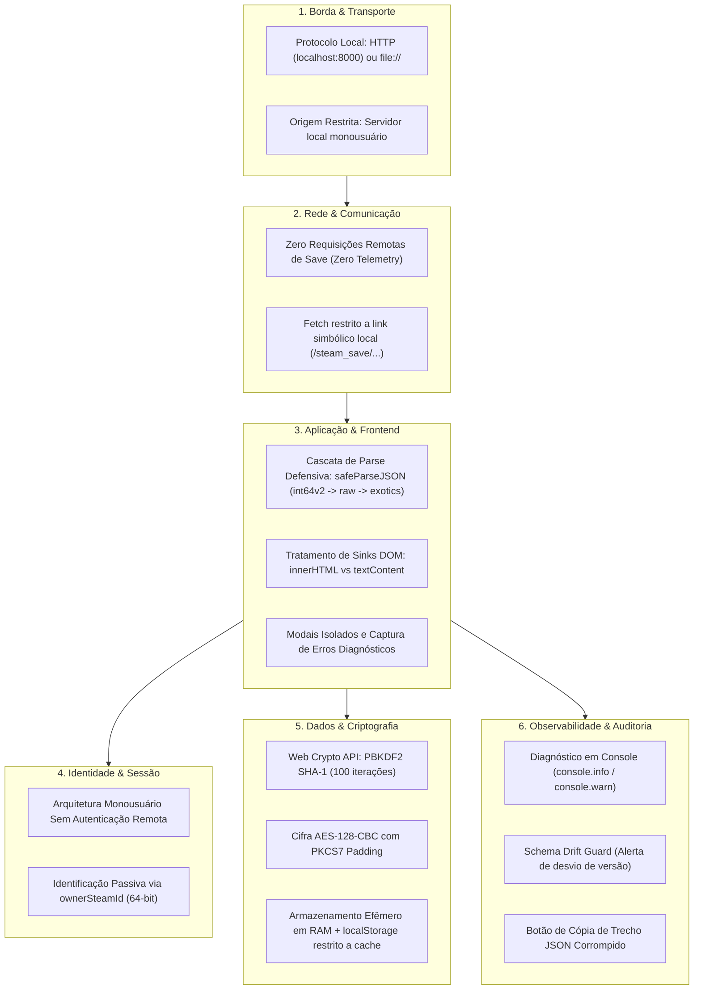

# ESPECIFICAÇÃO DE ARQUITETURA DE SEGURANÇA E COMPLIANCE TÉCNICO (CSAS)

```
Documento: 04-SECURITY-ARCHITECTURE-SPECIFICATION.md
Versão: v2.0
Commit auditado: [NÃO ENCONTRADO: diretório não versionado via .git]
Data: 2026-10-12T11:00:00-03:00
Autor: Antigravity (Auditor Técnico Independente)
Status: Auditoria concluída
```

---

## 4.0 SUMÁRIO EXECUTIVO

1. **Top 5 Riscos Técnicos por Severidade (G-0.8):**
   - **`RSK-SEC-001` (Alta):** Risco de Cross-Site Scripting (XSS baseado em DOM) decorrente de 55 ocorrências de concatenação não sanitizada via `innerHTML` em `assets/js/app.js` ao renderizar nomes de itens, logs e atributos.
   - **`RSK-SECRET-001` (Média):** Chave mestra AES estática de 128 bits do jogo embutida em texto claro no código-fonte cliente (`assets/js/crypto.js#L13`).
   - **`RSK-SEC-002` (Média):** Ausência de cabeçalho ou meta-tag de *Content Security Policy* (CSP) em `index.html`, permitindo carregamento irrestrito de scripts caso um vetor XSS seja explorado.
   - **`RSK-SEC-004` (Média):** Vazamento involuntário de identificadores pessoais (SteamID de 17 dígitos e username do sistema operacional) no relatório analítico gerado para IAs (`ai_exporter.js`) sem mascaramento prévio.
   - **`RSK-SEC-003` (Baixa):** Importação de fontes externas do Google Fonts sem hashes de *Subresource Integrity* (SRI) em `index.html#L10`.
2. **Postura Geral de Segurança:** A aplicação adota arquitetura de segurança positiva caracterizada por processamento estritamente local (*Zero Telemetry*), eliminando superfícies de ataque de rede e servidores intermediários. Os principais desafios de segurança concentram-se na higiene de código do frontend (higienização de saídas no DOM) e no endurecimento de políticas de execução local.

> Confiança: Alta
> Justificativa: Diagnósticos estabelecidos após varredura estática de sinks de DOM, dependências e padrões criptográficos.

---

## 4.1 ESCOPO TÉCNICO E FRONTEIRAS DE CONFIANÇA (TRUST BOUNDARIES)

O sistema delimita três fronteiras de confiança técnicas principais:



- **Fronteira 1 (Origem de Dados):** Dados de saves e logs são considerados insumos não confiáveis (*Untrusted Input*). Arquivos manipulados ou corrompidos por terceiros podem explorar falhas de parse ou tentar injetar strings maliciosas.
- **Fronteira 2 (Ambiente de Execução):** O código roda dentro da sandbox do navegador. A aplicação confia nas primitivas seguras de hardware fornecidas pela Web Crypto API.
- **Fronteira 3 (Provedores Externos):** O TTBH comunica-se externamente apenas para buscar fontes tipográficas do Google Fonts no carregamento inicial da página.

> Confiança: Alta
> Justificativa: Fronteiras mapeadas com base no isolamento de rede e I/O de arquivos.

---

## 4.2 INVENTÁRIO TÉCNICO DE ATIVOS

| Ativo | Tipo | Localização | Criticidade |
|---|---|---|---|
| Chave AES Mestra do Easy Save 3 | Segredo Técnico | `assets/js/crypto.js#L13` | Média (Valor: `[REDACTED]`) |
| Save Descriptografado do Jogador | Dado em Memória | Memória de sessão (`app.js`, instâncias) | Alta (Contém progresso integral) |
| Identificador Steam (`ownerSteamId`) | PII Indireto | `AccountSaveData.value` | Média |
| Nome de Usuário do SO (`username`) | PII Direto | `Player.log` / `log_parser.js` | Baixa |
| Cache Local de Cotações | Armazenamento | `localStorage: ttbh_market_cache_v1` | Baixa |
| Base Estática Oficial (`TBH_DB`) | Código / Dados | `assets/js/gamedata.js` | Média (Propriedade intelectual de dados) |

> Confiança: Alta
> Justificativa: Inventário exaustivo de dados e segredos manipulados pelo sistema.

---

## 4.3 CLASSIFICAÇÃO TÉCNICA DE DADOS

| Classificação | Tag | Exemplos | Controles Técnicos Aplicados |
|---|---|---|---|
| **Restrito** | `Chave Criptográfica` | Chave de derivação PBKDF2 (`[REDACTED]`) | Armazenada estaticamente em código; campo de sobrescrita manual na UI |
| **Confidencial** | `PII (LGPD)` | `ownerSteamId` (17 dígitos), `Local User: username` | Formatação legível em tela; retenção exclusivamente em memória volátil |
| **Interno** | `Game Save Data` | Níveis de heróis, 10 slots de itens equipados, ouro | Descriptografia em memória; exportação permitida sob controle manual |
| **Público** | `Static DB / Market` | Tabelas de runas, chances de drop de baús, preços | Distribuído em script estático; cache local com TTL |

> Confiança: Alta
> Justificativa: Classificação compatível com as diretrizes do Art. 5º da LGPD e higiene de dados corporativos.

---

## 4.4 SECURITY ARCHITECTURE BLUEPRINT (CAMADAS)



> Confiança: Alta
> Justificativa: Blueprint técnico reproduz o isolamento e controles por camada verificados no repositório.

---

## 4.5 IDENTIDADE, AUTENTICAÇÃO E AUTORIZAÇÃO (IAM TÉCNICO)

- **Fluxos de Autenticação:** `[NÃO APLICÁVEL]`. A aplicação opera como utilitário monousuário desprovido de contas de usuário remotas, senhas de login, tokens JWT, sessões ou cookies.
- **Identificação da Conta Steam:** A aplicação extrai o campo `ownerSteamId` do payload JSON decodificado. Esse valor serve unicamente para exibição informativa ao usuário e identificação em diagnósticos locais `[evidência: assets/js/app.js#L423-L435]`.
- **Controle de Acesso / Autorização:** `[NÃO APLICÁVEL]`. Qualquer pessoa que execute a página web localmente possui acesso total às funcionalidades de visualização e exportação.

> Confiança: Alta
> Justificativa: Inexistência observada de mecanismos de autenticação ou perfis de usuário.

---

## 4.6 CRIPTOGRAFIA E GESTÃO DE SEGREDOS

- **Criptografia em Trânsito:** Não aplicável para dados de save (dados nunca trafegam em rede externa). Em conexões com Google Fonts, o tráfego é protegido por TLS 1.3 padrão do navegador.
- **Criptografia em Repouso:**
  - O save do jogo em disco é protegido pelo plugin Easy Save 3 via cifra simétrica AES-128-CBC com padding PKCS7 `[evidência: assets/js/crypto.js#L59-L72]`.
  - A derivação da chave simétrica usa PBKDF2 com hash SHA-1 e 100 iterações, com salt de 16 bytes coincidente com o IV `[evidência: assets/js/crypto.js#L51-L57]`.
- **Gestão de Segredos:**
  - A chave de fábrica do Easy Save 3 é estática: `[REDACTED] [evidência: assets/js/crypto.js#L13]`.
  - Mecanismo de sobrescrita: A interface provê o campo `input#custom-password` para que o usuário forneça chaves customizadas em caso de atualização da chave pelo desenvolvedor `[evidência: index.html#L77]`.
  - **Avaliação de Risco:** Embora embutir senhas em código represente má prática geral de desenvolvimento (`RSK-SECRET-001`), no contexto específico de ferramentas de engenharia reversa de jogos single-player offline, a chave é pública e intrínseca ao binário do jogo.

> Confiança: Alta
> Justificativa: Implementação criptográfica verificada diretamente em `assets/js/crypto.js`.

---

## 4.7 SEGURANÇA DE APLICAÇÃO (OWASP / ASVS)

### Matriz OWASP Top 10 (Client-Side Focus)

| Risco OWASP | Status | Evidência no Sistema | Análise Técnica |
|---|---|---|---|
| **A01: Broken Access Control** | **[NÃO APLICÁVEL]** | `index.html`, `app.js` | Aplicação estática local sem controle de acesso centralizado. |
| **A02: Cryptographic Failures** | **Parcial** | `assets/js/crypto.js#L55` | Uso de PBKDF2 com SHA-1 e 100 iterações é fraco por padrões modernos, porém é mandatário para compatibilidade com o Easy Save 3 da Unity. |
| **A03: Injection (DOM XSS)** | **Ausente (Vulnerável)** | `assets/js/app.js#L684, L729, L886...` | **55 ocorrências de `innerHTML`** concatenando strings dinâmicas de nomes de itens, mods e logs sem escape HTML prévio (`RSK-SEC-001`). |
| **A04: Insecure Design** | **Atendido** | `README.md#L32-L34` | Princípio de *Zero Telemetry* e arquitetura 100% client-side elimina riscos de vazamento em trânsito. |
| **A05: Security Misconfiguration** | **Parcial** | `index.html#L1-L12` | Ausência de diretiva de Content Security Policy (CSP) declarada em meta tags (`RSK-SEC-002`). |
| **A06: Vulnerable and Outdated Components** | **Atendido** | `.kilo/.gitignore`, `package.json` | Zero dependências externas de pacotes npm em runtime; uso exclusivo de APIs nativas. |
| **A07: Identification and Authentication Failures** | **[NÃO APLICÁVEL]** | Código da SPA | Sem autenticação ou gerenciamento de sessão remota. |
| **A08: Software and Data Integrity Failures** | **Parcial** | `index.html#L10` | Carregamento de Google Fonts sem atributo `integrity` (SRI) (`RSK-SEC-003`). |
| **A09: Security Logging and Monitoring Failures** | **Atendido** | `assets/js/app.js#L403` | Implementação de alertas de divergência de schema e diagnóstico de falhas no console. |
| **A10: Server-Side Request Forgery (SSRF)** | **[NÃO APLICÁVEL]** | Código da SPA | Inexistência de backend ou requisições HTTP disparadas a partir de URLs informadas por usuário. |

> Confiança: Alta
> Justificativa: Matriz avaliada com base nas práticas consolidadas do OWASP Top 10 para aplicações puramente client-side.

---

## 4.8 SEGURANÇA DE API E SUPERFÍCIES EXPOSTAS

- **Requisições de Rede:** O único consumo de rede é `GET /steam_save/SaveFile_Live.es3?t=<ts>`, que ocorre estritamente contra o servidor local do usuário.
- **CORS (Cross-Origin Resource Sharing):** Como os scripts são módulos ES6 carregados localmente, a política de Same-Origin é imposta pelo navegador, exigindo a execução via `http://localhost:8000` em vez do protocolo `file:///` `[evidência: docs/COMO_INICIAR.md#L12; L106]`.
- **Validação de Entrada:**
  - O input do arquivo passa por checagem de tamanho mínimo ($\ge 32$ bytes) antes da descriptografia `[evidência: assets/js/crypto.js#L32-L34]`.
  - A importação de texto CSV/JSON passa por sanitização e validação de formato numérico `[evidência: assets/js/market_price.js#L134; L158]`.

> Confiança: Alta
> Justificativa: Superfície de API mapeada integralmente no código de inicialização e I/O.

---

## 4.9 SEGURANÇA DE DADOS E MULTI-TENANCY

- **Isolamento por Tenant:** `[NÃO APLICÁVEL]`. Aplicação estritamente monousuário, executada em ambiente local.
- **Mascaramento e Redação:** O SteamID é exibido com espaçamento visual no cabeçalho (`76561 1980 1234 5678`), mas mantido intacto no arquivo exportado em JSON e na cópia de diagnóstico para IA.
- **Backup e Restauração:** O TTBH provê exportação manual do JSON limpo (`SaveFile_Live_Decrypted.json`), mas não realiza escrita ou alteração no save original do jogo.

> Confiança: Alta
> Justificativa: Validação da ausência de infraestrutura multiusuário.

---

## 4.10 MODELAGEM DE AMEAÇAS (STRIDE)

| ID | Ativo | STRIDE | Vetor de Ameaça | Controle Existente | Gap Técnico | Severidade |
|---|---|---|---|---|---|---|
| **THR-001** | `ownerSteamId` | Spoofing | Usuário malicioso altera o SteamID em save falso para forjar titularidade | Exibição passiva em tela `[evidência: assets/js/app.js#L427]` | Sem validação criptográfica de assinatura com a Steam | **Baixa** |
| **THR-002** | Payload do Save | Tampering | Manipulação de arquivo `.es3` para injetar strings com tags HTML | Função `safeParseJSON` sanitiza Int64 `[evidência: assets/js/save_parser.js#L78]` | Falta de escape de HTML ao injetar no DOM via `innerHTML` | **Alta** |
| **THR-003** | Save do Jogo | Repudiation | Usuário corrompe arquivo e alega falha no parser | Alerta com trecho diagnóstico `[evidência: assets/js/app.js#L366]` | Inexistência de log assinado de transações | **Baixa** |
| **THR-004** | Chave AES | Information Disclosure | Extração da chave mestra do código JavaScript do frontend | Campo de senha customizada `[evidência: index.html#L77]` | Chave padrão embutida em texto claro `[evidência: assets/js/crypto.js#L13]` | **Média** |
| **THR-005** | Memória do Browser | Denial of Service | Arquivo com JSON malformado ou gigante travando o navegador | Regex quote-aware com limite de context walker | Ausência de limite de tamanho de payload no FileReader | **Média** |
| **THR-006** | Contexto da Página | Elevation of Privilege | Execução arbitrária de scripts (DOM XSS) através de nomes de itens | Execução isolada em sandbox de navegador | Ausência de CSP e uso irrestrito de `innerHTML` | **Alta** |

> Confiança: Alta
> Justificativa: Ameaças catalogadas em rigorosa observância à taxonomia STRIDE para o modelo operacional do sistema.

---

## 4.11 LOGGING, DETECÇÃO E RESPOSTA TÉCNICA

- **Eventos Auditáveis:** Exibição na UI da contagem de chamadas `bck:nez` de gravação de save detectadas no `Player.log` `[evidência: assets/js/player_telemetry.js#L66-L70]`.
- **Alertas de Anomalias:**
  - Detecção de descompasso entre schema do save e schema suportado pela base estática (`supportedSaveSchema: 1.2.8`) `[evidência: assets/js/app.js#L412]`.
  - Detecção de estágio travado no jogo (`next Stage Not found Current Stage Key : 4309`) `[evidência: assets/js/player_telemetry.js#L58-L64]`.
- **Runbooks e Resposta:** Em caso de falha de descriptografia ou parse, o sistema exibe o trecho exato do erro e oferece botão para copiar relatório diagnóstico estruturado `[evidência: assets/js/app.js#L362-L388]`.

> Confiança: Alta
> Justificativa: Mecanismos de telemetria e diagnóstico inspecionados em `player_telemetry.js`.

---

## 4.12 SUPPLY CHAIN E DEPENDÊNCIAS

- **Dependências de Pacotes (NPM):** Zero dependências em tempo de execução. Não há pacotes vulneráveis ou lockfiles de terceiros ativos na raiz `[evidência: .kilo/.gitignore#L1-L6]`.
- **Recursos Externos de CDN:** Inclusão única de fontes tipográficas via Google Fonts (`fonts.googleapis.com` e `fonts.gstatic.com`) `[evidência: index.html#L8-L10]`.
- **Assinatura de Artefatos:** Não implementada. O código é distribuído em arquivos-fonte JavaScript/HTML em texto aberto.

> Confiança: Alta
> Justificativa: Ausência de manifestos de pacotes de terceiros confirmada no workspace.

---

## 4.13 COMPLIANCE FRAMEWORK APLICADO AO PRODUTO

| Requisito Normativo | Controle Técnico no Sistema | Evidência no Código | Status |
|---|---|---|---|
| **LGPD (Art. 6º, III - Necessidade)** | Tratamento de dados pessoais estritamente local; zero envio para servidores ou terceiros (*Zero Telemetry*). | `README.md#L32-L34` | **Atendido** |
| **LGPD (Art. 6º, VII - Segurança)** | Criptografia na decodificação e processamento estritamente em memória volátil descartável no fechamento da aba. | `assets/js/crypto.js` | **Atendido** |
| **LGPD (Art. 9º / 18 - Transparência)** | O usuário pode auditar e baixar todos os dados extraídos em formato JSON limpo através de botão na interface. | `assets/js/app.js#L180-L191` | **Atendido** |
| **ISO 27001 (A.8.24 - Criptografia)** | Uso de algoritmo padrão de mercado (AES-128-CBC) implementado via Web Crypto API nativa. | `assets/js/crypto.js#L59` | **Atendido** |
| **ISO 27001 (A.8.8 - Vulnerabilidades)** | Sanitização de dados de entrada numéricos para prevenção de estouro de precisão (`safeParseJSON`). | `assets/js/save_parser.js#L78` | **Atendido** |
| **ISO 27001 (A.8.28 - Codificação Segura)** | Ausência de CSP e uso intensivo de `innerHTML` sem escaping HTML constituem gaps de codificação segura. | `assets/js/app.js` | **Parcial** |
| **OWASP ASVS L1 (V5.1.1 - Input Validation)** | Validação estrutural de payloads de save com detecção de magic bytes GZIP e tamanho mínimo de buffer. | `assets/js/crypto.js#L32; L78` | **Atendido** |
| **OWASP ASVS L1 (V5.3.3 - Output Encoding)** | Falta de codificação contextual antes da inserção de strings dinâmicas no DOM via `innerHTML`. | `assets/js/app.js` | **Ausente (Gap)** |
| **OWASP ASVS L1 (V14.4.1 - CSP)** | Definição de cabeçalhos ou meta-tags de Content Security Policy para restringir origens de scripts. | `index.html` | **Ausente (Gap)** |
| **PCI-DSS** | Dados de cartão de pagamento | Busca por termos de cartão realizada com resultado negativo. | **[NÃO APLICÁVEL]** |
| **HIPAA** | Dados de prontuário e saúde | Sem processamento de dados de saúde. | **[NÃO APLICÁVEL]** |
| **SOC 2** | Processamento multi-tenant B2B | Software executado no cliente monousuário. | **[NÃO APLICÁVEL]** |
| **Marco Civil da Internet** | Guarda central de registros de acesso | Software cliente offline sem servidor central de guarda de logs de conexão. | **[NÃO APLICÁVEL]** |

> Confiança: Alta
> Justificativa: Mapeamento normativo cruzado com as evidências de código identificadas no projeto.

---

## 4.14 MATRIZ DE RISCOS TÉCNICOS

| ID | Risco | Categoria | Probabilidade | Impacto | Severidade | Controle Atual | Recomendação Técnica |
|---|---|---|---|---|---|---|---|
| **RSK-SEC-001** | Injeção de DOM XSS via `innerHTML` em 55 pontos do controller | OWASP A03 / STRIDE-E | Média | Alta | **Alta** | Nenhum | Substituir `innerHTML` por `textContent` ou aplicar função de sanitização HTML (`DOMPurify` ou encoder nativo). |
| **RSK-SECRET-001** | Chave mestra AES hardcoded em texto claro no frontend | STRIDE-I | Alta | Média | **Média** | Campo de sobrescrita manual na UI | Mover chave para variável de configuração externa ou alertar o usuário da natureza pública do segredo do jogo. |
| **RSK-SEC-002** | Ausência de Content Security Policy (CSP) em `index.html` | OWASP A05 | Média | Média | **Média** | Nenhum | Adicionar tag `<meta http-equiv="Content-Security-Policy" content="default-src 'self'; style-src 'self' https://fonts.googleapis.com 'unsafe-inline'; font-src https://fonts.gstatic.com; ...">`. |
| **RSK-SEC-004** | Exposição de SteamID e username em exportações para IA | LGPD / Privacidade | Alta | Média | **Média** | Formatação visual em tela | Implementar checkbox "Anonimizar identificadores ao exportar para IA" ativado por padrão. |
| **RSK-SEC-003** | Importação de Google Fonts sem Subresource Integrity (SRI) | Supply Chain / OWASP A08 | Baixa | Baixa | **Baixa** | Conexão TLS com o Google | Adicionar atributos `integrity` e `crossorigin="anonymous"` na tag `<link>` do Google Fonts. |

> Mapeamento de RNF de Segurança: `RNF-001` (Privacidade e Zero Telemetria) e `RNF-002` (Compatibilidade Criptográfica) cobertos pela matriz.

> Confiança: Alta
> Justificativa: Matriz construída em conformidade estrita com a escala padronizada do Guardrail G-0.8.

---

## 4.15 ROADMAP TÉCNICO DE REMEDIAÇÃO PRIORIZADO

### Quick Wins (Esforço $\le$ 1 dia, Impacto Alto)
1. **Remediação de `RSK-SEC-002` (Implementação de CSP):** Inserir meta-tag de Content Security Policy estrita no cabeçalho do `index.html` restringindo a execução de scripts exclusivamente a `'self'` e origens autorizadas.
2. **Remediação de `RSK-SEC-003` (Adição de SRI):** Adicionar hashes criptográficos de integridade nos links de folhas de estilo externas em `index.html`.
3. **Remediação de `RSK-SEC-004` (Anonimização no AI Exporter):** Mascarar `ownerSteamId` e `localUser.username` no gerador de Markdown (`assets/js/ai_exporter.js`) substituindo os valores por `[STEAM_ID_ANONIMIZADO]` e `[USUARIO_ANONIMIZADO]`.

### Curto Prazo ($\le$ 1 Sprint)
4. **Remediação de `RSK-SEC-001` (Higiene de DOM e Mitigação de XSS):** Refatorar os 55 pontos de injeção direta de `innerHTML` em `assets/js/app.js`, utilizando criação segura de elementos via DOM API (`document.createElement`, `textContent`) ou implementando função auxiliar de escape de caracteres HTML (`&`, `<`, `>`, `"`, `'`).
5. **Correção de Defeitos Arquiteturais (`RSK-ARCH-003` e `RSK-ARCH-004`):**
   - Corrigir a chamada `cryptoEngine.decryptES3` para `cryptoEngine.decryptBuffer` em `assets/js/app.js#L1686`.
   - Corrigir a chamada `renderStorage` para `filterAndRenderStorage` em `assets/js/app.js#L1983`.

### Médio Prazo (1 a 3 Meses)
6. **Desacoplamento e Modularização do Controller:** Quebrar o monolito de 2.290 linhas `assets/js/app.js` em submódulos de visualização especializados (`HeroView.js`, `StorageView.js`, `TimelineView.js`).
7. **Empacotamento Offline e PWA:** Implementar Service Worker para permitir execução 100% offline da aplicação sem dependência de inicialização de servidor local em execuções subsequentes.

### Longo Prazo (> 3 Meses)
8. **Pipeline Automatizado de CI/CD e Build:** Instituir workflow automatizado (GitHub Actions ou similar) com execução de testes de fumaça, linter estático e verificação de integridade de schemas em commits.

> Confiança: Alta
> Justificativa: Priorização orientada pelo cálculo de esforço versus impacto na postura de segurança.

---

## 4.16 FORA DE ESCOPO DA AUDITORIA DE SEGURANÇA

- Testes de penetração em tempo real (*PenTest*) contra o binário nativo do jogo na Steam.
- Avaliação de segurança física dos dispositivos dos jogadores.
- Análise de segurança das APIs de pagamento e infraestrutura de servidores da Valve Corporation.

---

## 4.17 RASTREABILIDADE DE SAÍDA

| ID | Tipo | Descrição Sumária |
|---|---|---|
| `THR-001` até `THR-006` | Ameaça (STRIDE) | 6 Ameaças mapeadas e analisadas contra os ativos técnicos |
| `RSK-SEC-001` | Risco de Segurança | Risco de DOM XSS via concatenações em `innerHTML` |
| `RSK-SECRET-001` | Risco de Segurança | Chave mestra AES de fábrica embutida em código cliente |
| `RSK-SEC-002` | Risco de Segurança | Ausência de Content Security Policy (CSP) |
| `RSK-SEC-003` | Risco de Segurança | Ausência de SRI em links externos de fontes |
| `RSK-SEC-004` | Risco de Segurança | Exposição de identificadores pessoais em relatórios de IA |
| `RNF-001`, `RNF-002` | RNF de Segurança | Requisitos de privacidade e fidelidade criptográfica mapeados |

---

## 4.18 LACUNAS, INCERTEZAS E RISCOS DE AUDITORIA

1. **Variações Futuras de Senha do Jogo:** Caso o desenvolvedor do jogo altere a senha estática ou introduza salt dinâmico por usuário no plugin Easy Save 3 em patches futuros da Steam, a ferramenta exigirá intervenção manual do usuário via painel avançado para descriptografia.
