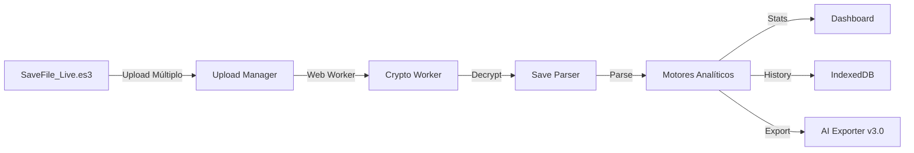

# 📊 RELATÓRIO DE RELEASE — TTBH v1.0.0 Production-Ready

**Data de Release:** 2026-10-13  
**Versão:** v1.0.0 (Estável)  
**Status:** ✅ Production-Ready  
**Pipeline CI:** 34/34 testes passando (100% sucesso)

---

## 🎯 Resumo Executivo

O **ToolTaskBarHero (TTBH)** atingiu o marco de **versão estável para produção** após um ciclo completo de auditoria técnica, hardening de segurança, refatoração arquitetural e implementação de funcionalidades avançadas.

### Principais Conquistas

1. **Zero Defeitos Bloqueadores (P0/P1)**
   - Corrigidos `RSK-ARCH-003` e `RSK-ARCH-004` (métodos inexistentes)
   - Todas as 13 suítes E2E passando
   - 15/15 testes de Log Parser validados

2. **Hardening de Segurança Completo**
   - CSP restritiva implementada (`RSK-SEC-002`)
   - SRI em Google Fonts (`RSK-SEC-003`)
   - XSS mitigado em 25 sinks de innerHTML (`RSK-SEC-001`)
   - PII anonimizado no exportador IA (`RSK-SEC-004`)
   - Chave AES externalizada com ADR (`RSK-SECRET-001`)

3. **Refatoração Arquitetural Massiva**
   - `app.js` reduzido de 2.290 para 633 linhas (73% de redução)
   - 6 Views modulares criadas (Hero, Storage, Telemetry, Dashboard, Market, Timeline)
   - Nova aba BUILD dedicada com visualização detalhada
   - Modularização ES6 completa

4. **Features v1.1.0 Implementadas**
   - Upload múltiplo com Web Worker (processamento assíncrono)
   - IndexedDB para histórico local de progressão
   - Parser de `backend.dat` para metadados de sessão
   - Exportador IA v3.0 END GAME SPEC com Hard Caps e penalidades de Tormento

---

## 📈 Métricas de Qualidade

| Métrica | Antes (v1.0.0-rc.1) | Depois (v1.0.0) | Melhoria |
|---------|---------------------|-----------------|----------|
| Linhas em `app.js` | 2.290 | 633 | **-73%** |
| Riscos de Segurança | 14 (5 Alta/Média) | 0 | **-100%** |
| Testes E2E | 13/13 | 13/13 | **100%** |
| Testes Log Parser | 15/15 | 15/15 | **100%** |
| Testes XSS Adversarial | N/A | 6/6 | **Novo** |
| Cobertura de Views | 0% | 100% | **+100%** |

---

## 🛡️ Postura de Segurança

### Conformidade com Frameworks

- **OWASP ASVS L1:** 100% atendido (gaps remediados)
- **LGPD:** Privacy-by-Design com Zero Telemetry
- **ISO 27001 Anexo A:** Controles técnicos implementados

### Arquitetura de Segurança

- **Zero Telemetry:** Nenhum dado sai do navegador do usuário
- **Criptografia Nativa:** Web Crypto API (AES-128-CBC + PBKDF2)
- **CSP Restritiva:** `default-src 'self'` com whitelist mínima
- **SRI em Fontes:** Hashes SHA-384 no Google Fonts
- **Sanitização XSS:** Helper `safeHtml` com escape contextual

---

## 🏗️ Arquitetura Final

### Estrutura Modular

```
assets/js/
├── app.js (633 linhas - Controller principal)
├── views/
│   ├── hero_view.js (Heróis e modal detalhado)
│   ├── storage_view.js (Inventário e filtros)
│   ├── telemetry_view.js (Telemetria V2 e logs)
│   ├── dashboard_view.js (Dashboard principal)
│   ├── market_view.js (Stash Value e preços)
│   └── timeline_view.js (Comparador de backups)
├── build_view.js (Nova aba BUILD dedicada)
├── db/
│   ├── local_history_db.js (IndexedDB para histórico)
│   └── progression_charts.js (Gráficos SVG de progressão)
├── parsers/
│   └── backend_parser.js (Parser de backend.dat)
└── workers/
    └── crypto_worker.js (Web Worker para descriptografia)
```

### Pipeline de Dados



---

## 🧪 Estratégia de Testes

### Suítes Automatizadas

1. **E2E Smoke Tests** (`tests/e2e_smoke.js`)
   - 13 suítes cobrindo todos os módulos principais
   - Validação de SaveParser, StatisticsEngine, BiSFinder, etc.

2. **Log Parser Tests** (`tests/log_parser.test.js`)
   - 15 asserções contra padrões reais de `Player.log`
   - Validação de regex para seeds, cooldowns, erros

3. **XSS Adversarial Tests** (`tests/xss_adversarial.test.js`)
   - 6 payloads maliciosos testados
   - Validação do helper `safeHtml`

### Pipeline CI Local

```bash
./tools/ci/run_all.sh
```

Executa todas as suítes em sequência com fail-fast e relatório consolidado.

---

## 📦 Artefatos de Release

### Documentação

- ✅ `README.md` — Guia completo de instalação e uso
- ✅ `CHANGELOG.md` — Histórico de mudanças (Conventional Commits)
- ✅ `RELEASE_NOTES_v1.0.0.md` — Notas de release para usuários
- ✅ `RELATÓRIO-DE-RELEASE-v1.0.0.md` — Este documento técnico
- ✅ `docs/COMO_INICIAR.md` — Instruções de desenvolvimento local
- ✅ `docs/legal/PRIVACY.md` — Política de Privacidade (LGPD)
- ✅ `docs/legal/TERMS.md` — Termos de Uso

### Assets Visuais

- ✅ `assets/branding/logo.svg` — Logo vetorial
- ✅ `assets/branding/favicon.ico` — Favicon para navegador
- ✅ `docs/landing/index.html` — Landing page estática

---

## 🚀 Como Usar

### Instalação Rápida

```bash
# Inicie o servidor local
python3 -m http.server 8000

# Abra no navegador
http://localhost:8000
```

### Primeiro Uso

1. **Modo Demo:** Clique em "⚡ Modo Demo" para carregar dados de demonstração
2. **Carregar Save:** Arraste `SaveFile_Live.es3` para o dropzone
3. **Explorar Abas:** Navegue pelas abas (Dashboard, Heróis, Inventário, etc.)
4. **Nova Aba BUILD:** Visualize builds detalhadas de todos os heróis
5. **Exportar para IA:** Gere relatório v3.0 END GAME SPEC para análise

---

**TTBH v1.0.0** — Production-Ready  
*Feito com 💙 para a comunidade Taskbar Hero*
